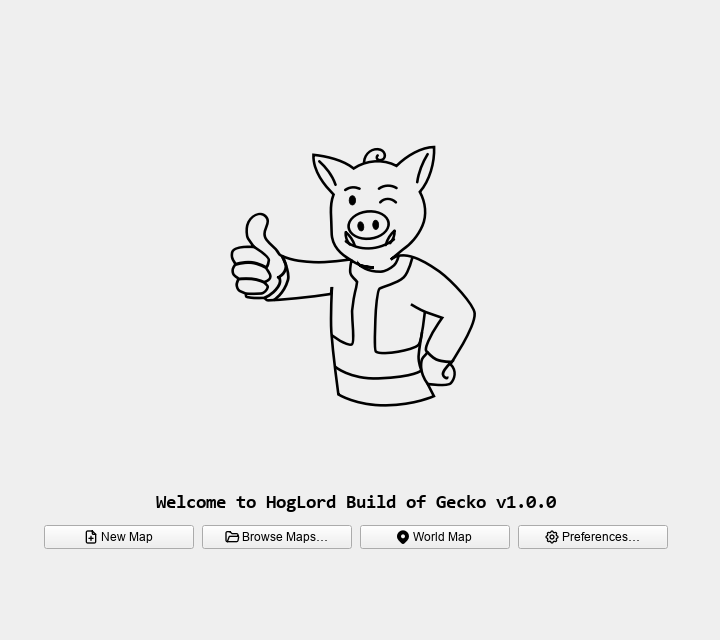
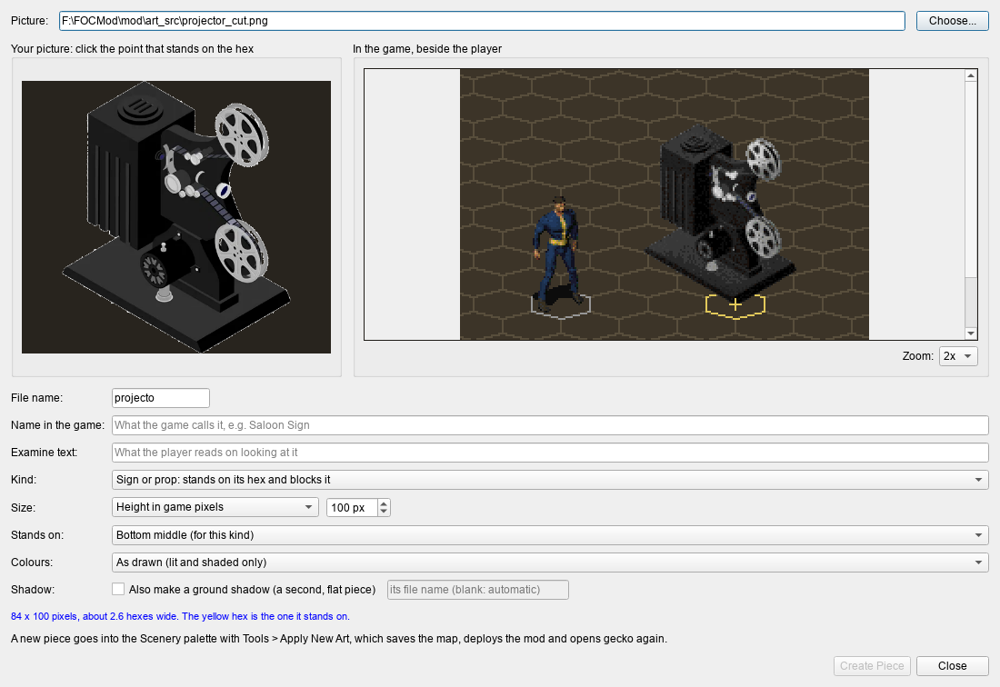
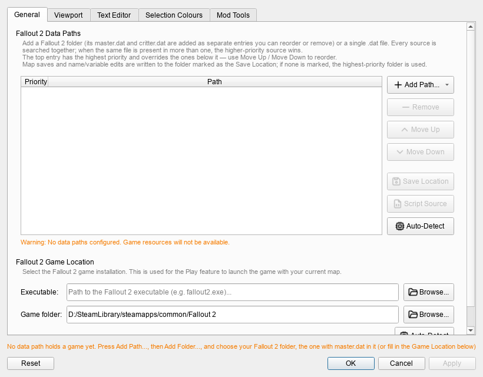

# HogLord Build of Gecko

My build of [gecko](https://github.com/JanSimek/gecko), Jan Simek's Fallout 2 map editor, with the tools I use to make maps for my Fallout 2 mod. This page covers only what this build adds. For the editor itself (its controls, its tools, how it is built) see [gecko's own README](https://github.com/JanSimek/gecko#readme).

It keeps gecko's own files and folders: the program is still `gecko.exe`, and its settings and stamps live where gecko keeps them (`%LOCALAPPDATA%\gecko\gecko`).

## Download

Windows builds are on the [releases page](https://github.com/HogLord69/gecko/releases). Unzip anywhere and run `gecko.exe`. On first launch Preferences opens: press **Add Path...**, then **Add Folder...**, and choose your Fallout 2 folder (the one with `master.dat` in it). No game data is included, so you need your own copy of the game.

List one game at a time. Each game numbers its art and objects in its own lists, so with two games listed the top one's lists win and the other's maps show the wrong pieces. To use another game's pieces, see the next section.

## What this build adds

### Pieces from other games

The object palette has a **Game** list. Pick another game you have installed and the palette shows its pieces, read from your own install and kept apart from your game's data. **Only pieces Fallout 2 doesn't have** (on at first) leaves out the Fallout 2 pieces every total conversion carries, judged by the picture: of Fallout: Sonora's 2,377 scenery pieces it shows the 1,675 that are its own.

Drop one on the map and it is brought into your mod first, with new numbers, so it works in your game and shows at once; **Tools > Apply New Art** puts it in the game. Dropping it again uses the same copy. Scenery, walls, misc pieces and items that have no inventory picture (desks, lockers, chests, keys) come across. Critters, weapons, armor, ammo and drugs are refused with the reason: their other numbers (AI packet, talking head, ammo, inventory picture) would point at the wrong things. A piece's script stays behind, since its number means another script in your game.

This needs a mod folder with the mod tools (`tools/gecko_assets.py`, and `tools/sources.json` naming the games and where they are installed), set in **File > Preferences > Mod Tools**.

### Stamps that come with it

**Edit > Stamp Pattern** lists the stamps that come with this build under your own, as **Came with gecko**: 1,567 buildings, graveyards, junkyards and ruins cut from Fallout 1, Fallout 2, Sonora, Nevada, Resurrection and Olympus, sorted by what they are built from, and **HogLord Props**, 21 props of my own. Nothing has to be copied anywhere. A stamp holds its game's object numbers, not pictures, so use each folder with the game it is named for. The credits are in [`resources/stamps/README.md`](resources/stamps/README.md).

### New scenery from a picture

**Tools > Add Scenery from Picture** turns a render or photo into a new scenery piece: cut out, shaded like Fallout 2's pre-rendered art and put in the game's palette, with its own art, proto, name and examine text. The preview stands it on the hex grid beside the player, for scale; a click on the picture picks the point it stands on. On the map's right-click menu, **Mirrored Copy**, **Bigger or Smaller Copy** and **Name and Examine Text** work on the one selected piece.

### Buildings cut into walls

**Tools > Cut Building into Walls** cuts a building rendered with the Fallout camera into wall pieces, one per hex, on the same screen columns as Fallout 2's own walls (32 and 16 pixels on a 14 degree wall, 16 on a 37 degree one). Click the foot of the walls; Shift-click the top of a wall, and the roof above it becomes roof tiles. A stamp lays the whole building down.

### Apply New Art

**Tools > Apply New Art** saves the map, closes gecko, deploys the mod in a window that numbers the steps, says FINISHED and closes itself, and opens gecko again on the map. The steps run on their own, so closing the window early stops nothing.

### First-run setup that finds your game

A Fallout 2 folder named only in the **Game Location** (the Play button's fields, under the data paths) is read as the game's data too. **Auto-Detect** finds Fallout 2 in every Steam library on any drive (`D:\SteamLibrary`) and reads the registry keys GOG and Steam write from their 32-bit installers. While no game is listed, Preferences says which buttons to press.

### Fallout 1 maps

Point it at a Fallout 1 install and open its maps: Fallout 1's archives (`MASTER.DAT`, `CRITTER.DAT`, with their LZSS packing) and its version-19 maps, ladders included, are read and saved. Above, Junktown's entrance drawn by `gecko-cli map render`.

### Editing

- **Copy, cut and paste of map areas** (Ctrl+C / Ctrl+X / Ctrl+V): floor and roof tiles and objects, onto another elevation or into another map. A ghost follows the cursor and each click drops a copy.
- **Right-click menu** on the map: Cut / Copy / Paste, the draw order (Bring to Front, Bring Forward, Send Backward, Send to Back; also Home / PgUp / PgDn / End) and **Put on Top**, which makes a piece on a table or shelf show on top of it in the game the way it does in the editor.
- **Black Edge** and **Add / Remove Blocker** tools.
- Each object is drawn at its own pixel offset, as the game draws it.

### Smaller changes

- New items hold what the game gives them: an ammo box has its rounds, a weapon its ammo, and a container is saved with room for its items. Ammo amounts are entered in rounds, as they are shown.
- A bag inside a critter's inventory loads instead of failing the map; an object whose art can't be found is skipped instead of stopping the map.
- The file browser's **Only the mod's own files** switch hides what the .dat archives provide, so the list is your mod's maps.
- A data path that can't be loaded is reported and skipped instead of closing gecko.
- `gecko-cli map strip-exit-grids --map maps\arvillag.map --out out.map --data "C:\Games\Fallout 2\master.dat"`.
- Only one copy runs at a time, and the settings are sturdier.

## The map workflow

[`workflow/`](workflow/README.md) holds the whole toolkit I use to make Fallout 2 maps with this build: browsing the original games and the total conversions and saving their buildings as stamps, converted to your mod's numbers; planning a site to scale; building and finishing a map the way Fallout 2 does; putting it in the game. It needs Python 3.10 or newer and Fallout 2 with the Restoration Project Unofficial: open a terminal in `workflow`, run `python setup.py`, then `python foc.py`.

## Building

It builds exactly as gecko does: see [gecko's README](https://github.com/JanSimek/gecko#building-from-source). The pictures on this page are drawn by `qt_tests "[.readme]"` (see `tests/qt/test_readme_shots.cpp`).

## Credits

gecko is Jan Simek's, under the Apache 2.0 licence ([LICENSE](LICENSE)); this build's changes are under the same licence. Fallout is a trademark of Bethesda Softworks LLC. The stamps carry the credits of the games they were cut from.
